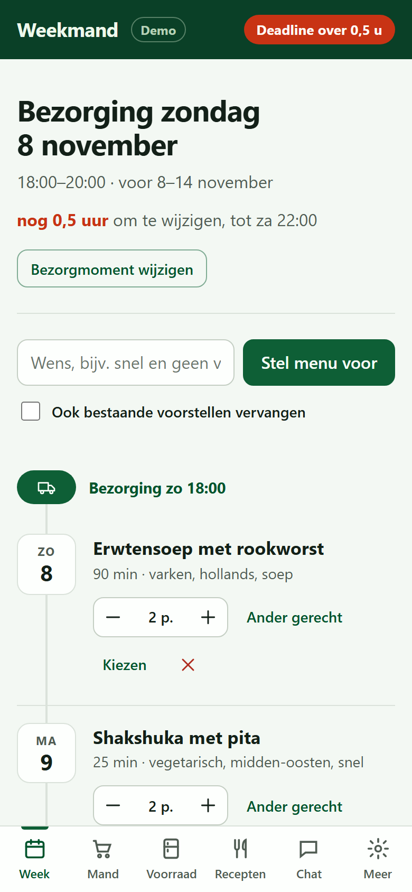
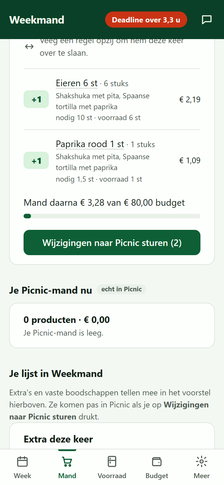
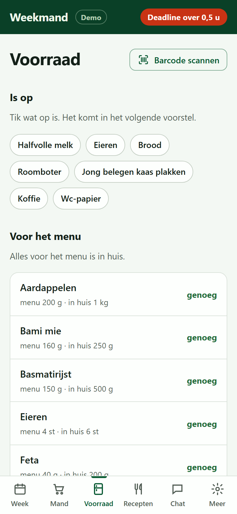
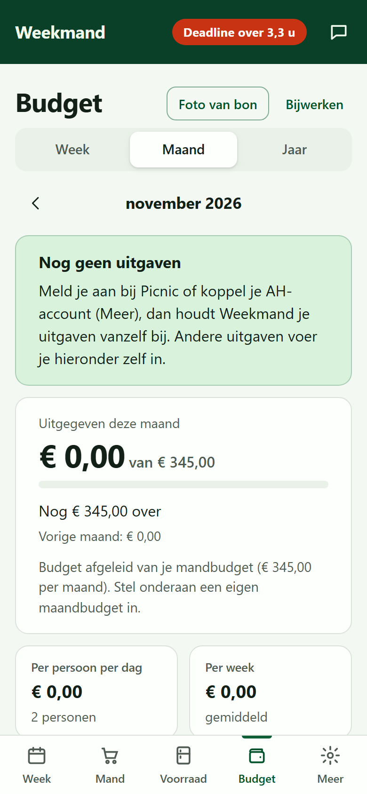

# Weekmand

Weekmand is een lokale boodschappenassistent voor een huishouden dat bij Picnic bestelt. Het stelt een weekmenu voor, rekent uit wat er nodig is en vult alleen het verschil aan in de Picnic-mand. Het bestelt en betaalt nooit zelf: dat doe je in de Picnic-app. Het houdt de voorraad bij, meldt via Telegram wanneer de mand vóór de deadline klaar moet zijn, en is te bedienen via de webapp, chat, Claude (MCP) of Home Assistant.

<p align="center">
  
  
  
  
</p>

Meer details: [docs/DETAILS.md](docs/DETAILS.md).

## Instellen

Eenmalig, op de computer waarop Weekmand draait:

1. Installeer [Node.js](https://nodejs.org) (versie 24.13 of nieuwer) en [Git](https://git-scm.com).
2. Open een terminal (op Windows: PowerShell) en kloon de code naar een map van jou:

   ```sh
   git clone https://github.com/RoanWassink/weekmand.git
   ```
3. Ga **in de map van Weekmand** staan. `npm start` werkt alleen daar, niet in een willekeurige map:

   ```sh
   cd weekmand
   ```

4. Installeer de onderdelen (duurt even):

   ```sh
   npm ci
   ```

Daarna starten en openen:

```sh
npm start
```

Open [http://127.0.0.1:8080](http://127.0.0.1:8080) in je browser. Zonder verdere instellingen draait een demowinkel, zodat je alles kunt uitproberen. Stoppen doe je met Ctrl+C in de terminal.

Een volgende keer hoef je alleen `cd weekmand` en `npm start` te doen.

Onder **Meer** in de app:

- Maak een account aan.
- **Winkel en Picnic**: meld je aan met de sms-code en vink **Sessie onthouden** aan, zodat de deadline-melding ook na een herstart werkt. Geen Picnic? Kies **Zelf boodschappen doen**: dan wordt de tab Mand een boodschappenlijst (per afdeling of per gerecht) om af te vinken in de winkel.
- **AI-aanbieder** (optioneel): Claude, OpenAI, Mistral, DeepSeek of een lokaal model.
- **Albert Heijn** (optioneel): voor boodschappen in de winkel. Weekmand zet je boodschappen op Mijn lijst in de AH-app en telt je kassabonnen bij de voorraad.
- **Lidl Plus** (optioneel): Weekmand leest je Lidl-kassabonnen voor het budget en de voorraad.
- **Telegram-meldingen** (optioneel): maak een bot bij @BotFather en koppel die met een koppelcode. Ieder in huis kan een eigen chat koppelen; wat de bot in de ene chat verandert, lezen de anderen mee.

De tab **Budget** laat zien wat je echt uitgaf (Picnic, AH- en Lidl-kassabonnen en losse uitgaven) per week, maand en jaar, per categorie en nodig tegenover extra.

Stap-voor-stap uitleg voor AI-sleutels (Mistral, DeepSeek, OpenAI, Claude) en de Telegram-bot: [docs/KOPPELEN.md](docs/KOPPELEN.md).

Instellingen kun je ook in een `.env`-bestand zetten; zie `.env.example`.

Naar een NanoPi R4S met OpenWrt uitrollen doe je met `deploy/Update-Weekmand.ps1` (vereist PowerShell 7). Met Docker start je Weekmand met `docker compose up --build -d`.

## Gebruiken

Elke week:

1. **Week**: maak het weekmenu, kies het bezorgmoment en keur het goed. Vink gerechten aan die je hebt gekookt, of vervang ze door **Ander gerecht**.
2. **Mand**: bekijk de boodschappen (met productfoto's) die Weekmand heeft berekend en klik op **Wijzigingen naar Picnic sturen**. Wat je zelf in de Picnic-mand hebt gelegd, blijft staan.
3. Rond de bestelling af en betaal in de Picnic-app.
4. **Voorraad**: klik op **is op** als iets op is, of scan de barcode van het product.
5. **Recepten**: geef gerechten een duimpje omhoog of omlaag, zodat het volgende menu beter past.
6. Vier uur voor de deadline krijg je een Telegram-melding. Vul dan het menu aan en keur de mand goed.

Je kunt Weekmand ook gewoon een bericht sturen, bijvoorbeeld: "We eten vrijdag met zes man Mexicaans."
